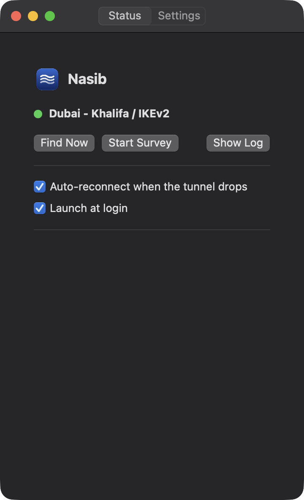
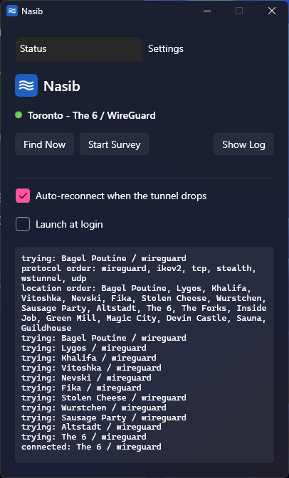
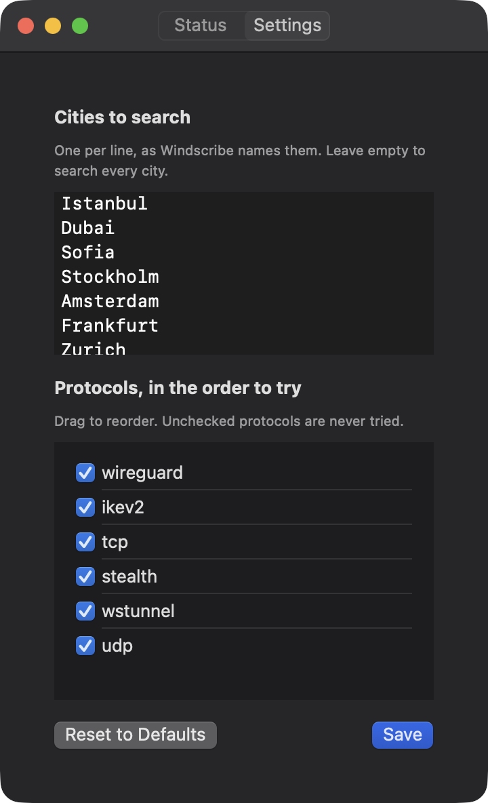
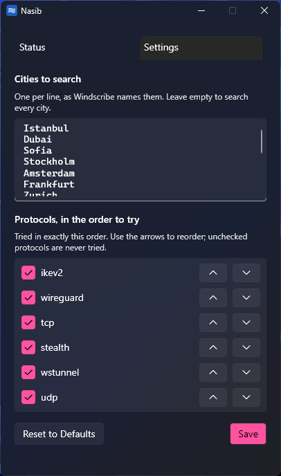
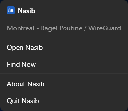

<p align="center">
  
</p>

<h1 align="center">Nasib</h1>

<p align="center">Keeps Windscribe connected from networks that block most of it.</p>

<p align="center">
  <b>macOS</b> 15 or later, Apple silicon &nbsp;·&nbsp; <b>Windows</b> 10 and 11, x64 &nbsp;·&nbsp; <b>Linux</b> x64 (preview)<br>
  <a href="https://github.com/ArefMozafari/Nasib/releases/latest">Download the latest release</a>
</p>

<p align="center">
  Works with the <a href="https://windscribe.com">Windscribe</a> desktop app. Not affiliated with Windscribe.
</p>

---

Nasib (نصیب, roughly "your share") lives in the macOS menu bar, the Windows notification area or the
Linux tray. It
finds a Windscribe datacenter and protocol that actually carries traffic right now, connects to it,
and does it again when the tunnel dies.

It's for heavily filtered networks, where the server that works changes by the hour, and trying them
one by one in the Windscribe app takes longer than the connection lasts.

| macOS | Windows |
|:---:|:---:|
|  |  |

## How it decides

1. **Knows every Windscribe datacenter.** Nasib bundles all of them (about 200) and adds whatever
   Windscribe's own log shows, so a new server turns up once Windscribe has touched it. You choose
   which ones to search, in your order.
2. **Tries the last pair that worked first**, on the port it worked on.
3. **Knocks on every address at once** and drops the ones that don't answer at all. That takes about
   two seconds and usually rules out half the list.
4. **Tries each protocol in the order you set**, on your locations in your order. With "Rank by recent
   success" on, the locations that worked best over the last 300 attempts go first.
5. **Tries other ports when the usual ones fail.** The first pass uses each protocol's default
   port, or a port that has worked better here. Only when nothing works does a second pass try the
   protocol's other ports. Ports that worked come first, then ports not tried yet, then ports that
   only failed.
6. **Gives each attempt 10 seconds**, not the 40-odd the Windscribe CLI waits on its own.
7. **Counts a connection only when a blocked site loads through it.** Windscribe reporting
   "Connected" isn't enough; on a filtered network that often happens with nothing getting through.

The output pane shows each stage of a search as it starts, and the port of every attempt.

## Install

### macOS

- **Needs:** macOS 15 or later on Apple silicon, and the Windscribe desktop app, logged in. Nasib
  drives its command-line tool, `/usr/local/bin/windscribe-cli`.
- **Install:** download `Nasib-<version>-macos.zip` from the
  [latest release](https://github.com/ArefMozafari/Nasib/releases/latest), unzip it, and move
  `Nasib.app` to Applications.
- **First launch:** the build isn't notarized, so macOS blocks it. Allow it under System Settings →
  Privacy & Security → Open Anyway, or clear the quarantine flag:

  ```bash
  xattr -dr com.apple.quarantine /Applications/Nasib.app
  ```

- **Launch at login:** move the app to where it will stay first. The login item points at its
  current location.

<p align="center">
  
</p>

### Windows

- **Needs:** 64-bit Windows 10 or 11, and the Windscribe desktop app, logged in. Nasib drives its
  command-line tool, `C:\Program Files\Windscribe\windscribe-cli.exe`. The .NET runtime is inside
  the executable, so nothing else needs installing.
- **Install:** download `Nasib-<version>-win-x64.zip` from the
  [latest release](https://github.com/ArefMozafari/Nasib/releases/latest), unzip it, and keep
  `Nasib.exe` and `nasib-engine.exe` together in a folder where they will stay, such as
  `%LOCALAPPDATA%\Programs\Nasib`. Nasib runs the engine from its own folder.
- **First launch:** the build isn't signed, so SmartScreen warns. Choose More info, then Run anyway.
- **Tray icon:** Nasib opens its window on launch, then lives in the notification area. Windows 11
  hides new icons in the overflow; to keep the waves on the taskbar, turn Nasib on under Settings →
  Personalization → Taskbar → Other system tray icons.
- **Launch at login:** starts Nasib in the notification area without the window, from wherever
  `Nasib.exe` was when you turned it on.

<p align="center">
  
  
</p>

### Linux (preview)

The Linux app is new in 1.0.0 and hasn't been tested on a real Windscribe connection yet. Reports are
welcome in [issues](https://github.com/ArefMozafari/Nasib/issues).

- **Needs:** an x64 desktop with GTK 4.6 or later (Ubuntu 22.04, Debian 12, Fedora 38, Linux Mint 21
  or newer), and Windscribe's Linux app, logged in. Nasib drives its command-line tool,
  `/usr/bin/windscribe-cli`.
- **Install:** download one of these from the
  [latest release](https://github.com/ArefMozafari/Nasib/releases/latest):
  - Ubuntu, Debian, Mint: `Nasib-<version>-linux-x64.deb`, then
    `sudo apt install ./Nasib-<version>-linux-x64.deb`;
  - Fedora: `Nasib-<version>-linux-x64.rpm`, then `sudo dnf install ./Nasib-<version>-linux-x64.rpm`;
  - anything else: `Nasib-<version>-linux-x64.tar.gz`, then unpack it and run `./nasib/install.sh`,
    which installs into `~/.local` without root. `./nasib/install.sh uninstall` removes it.
- **Tray icon:** KDE, Cinnamon, Xfce, MATE and Ubuntu's GNOME show it. Stock GNOME, as on Fedora and
  Debian, needs the AppIndicator extension. Without a tray, the window stays open and closing it
  quits Nasib.
- **Launch at login:** adds `~/.config/autostart/nasib.desktop`, which starts Nasib in the tray.
- **Dark mode** follows the desktop's light or dark setting.

### Set Windscribe's anti-censorship options yourself

- Windscribe's Anti-Censorship preferences (Protocol Tweaks, the Amnezia config and Server Routing)
  can't be changed from its command-line tool, so Nasib uses whatever the Windscribe app has.
- On a heavily filtered network, open Windscribe's preferences once, go to Anti-Censorship, turn on
  Protocol Tweaks and pick the Amnezia config that matches your network.

## Using it

**The icon**
- The waves in the menu bar, notification area or tray are solid when connected, dashed while
  searching, and crossed out when down.
- Clicking them opens a menu: the current server, Open Nasib, Find Now, About and Quit. On Windows
  and Linux, the menu is on right-click, and a left click opens the window.
- Closing the window doesn't quit the app, except on a Linux desktop with no tray.

**The controls** (hover over any of them for a one-line explanation)
- **Find Now** runs one search and stops at the first pair that works. While it runs, it reads
  **Stop**, which ends the search and disconnects.
- **Start Survey** tries every location on every protocol and records each result, without stopping
  at a success. It covers every port too. It's slow, and it's how the rankings get refreshed.
  **Stop Survey** ends it and puts you back on the last pair that worked.
- **Auto-reconnect** reads the tunnel status every 3 seconds and checks a blocked site once a minute,
  and searches when either fails.
- **Settings** holds the locations to search and the protocols to try, each in your order.
  - Your locations are a list you check and put in order: drag them on macOS and Linux, use the arrows
    on Windows.
    Add more from every Windscribe datacenter, grouped by region. Both lists have a search field, and
    Select all and Deselect all act on what the search shows, or on one region. "Rank by recent success"
    reorders them by what worked lately; turn it off to follow your order exactly. Cities saved by an
    older version carry over as the same locations. Settings won't save with no location or no protocol
    checked.

**What it tells you**
- The output pane colors each line: green when it connects, gray for a failed attempt, orange when
  the tunnel drops, and red only when nothing works. Teal lines mark each stage of a search.
- Notifications come when it connects, when the tunnel drops, and when nothing works.
- **Updates:** Nasib asks GitHub for the latest release at launch and once a day. When there's a
  newer one, you get an **Update to** button next to the app name, the same item in the menu, and one
  notification. Each opens the release page; download the new version and replace the app, or on
  Linux install the new package over the old one. Nasib never installs anything itself.

**Where it keeps things:** everything Nasib keeps is in `~/.ws-find` on macOS, `%LOCALAPPDATA%\Nasib`
on Windows and `~/.local/share/nasib` on Linux:

| File | What's in it |
|---|---|
| `log.csv` | Every attempt: time, datacenter, protocol, `ok` or `fail`, and the port |
| `last_good` | The last datacenter, protocol and port that worked |
| `config.json` | What you saved in Settings. Older macOS versions kept it in `config`, which is converted once and removed. |
| `preferences.json` (Windows, Linux) | Whether auto-reconnect is on, and the last update you were told about |

## Building from source

### Engine

`Engine/` holds `nasib-engine`, the Rust program that does the searching. Every app runs it. You need
the Rust toolchain. From the repository root:

```bash
cd Engine
cargo test
```

- The tests run against a fake `windscribe-cli` and fake probes, so they never touch the real VPN.
- The engine also works without an app: `nasib-engine` with no arguments searches once, and it takes
  `--watch`, `--survey`, `--reach`, `--rank`, `--locations` and `--status`.
- [`Engine/README.md`](Engine/README.md) describes each mode, the lines the apps read, and the exit codes.

### macOS

Everything for the macOS app is under `macOS/`. You need Xcode and the Rust toolchain. From the
repository root:

```bash
./macOS/build.sh install
```

- `./macOS/build.sh install` builds `macOS/build/Nasib.app` with the engine inside, copies it to
  `~/Applications` and launches it.
- `./macOS/build.sh` builds without installing.
- `./macOS/build.sh release` runs the app's and the engine's tests, then writes
  `macOS/build/Nasib-<version>-macos.zip`.
- `swift test`, run in `macOS/`, runs the app's tests alone.

### Icons

- `Design/` at the repository root holds the icon sources both apps use: an Icon Composer document
  for the macOS app icon, which macOS 26 renders as Liquid Glass, and one SVG per menu bar state.
- `macOS/build.sh` compiles them; no PNG is exported by hand.

### Windows

Everything for the Windows app is under `Windows/`: the WPF app and its tests. You need the .NET 9 SDK,
and Rust with the `x86_64-pc-windows-msvc` target, which is the default on Windows. From PowerShell:

```powershell
./Windows/build.ps1
```

- `build.ps1` runs the engine's and the app's tests, builds the engine, then writes
  `Windows/build/Nasib-<version>-win-x64.zip` with a self-contained `Nasib.exe` and `nasib-engine.exe`.
- `dotnet test Windows/Nasib.sln` runs the app's tests alone. A debug build copies the engine next to
  `Nasib.exe` once `cargo build --release --target x86_64-pc-windows-msvc` has built it in `Engine/`.
- The tray glyph and the app icon are drawn from the same path data as the SVGs in `Design/`; the
  build writes the `.exe` icon from it with `Windows/tools/Nasib.IconBuilder`.

### Linux

Everything for the Linux app is under `Linux/`: the GTK 4 app in Rust and its tests. You need Docker;
everything builds in an Ubuntu 22.04 container, so the binaries run on every target distro. From the
repository root:

```bash
./Linux/build.sh
```

- `./Linux/build.sh` runs the engine's and the app's tests for this machine's architecture. It needs
  bash and Docker.
- `./Linux/build.sh release` runs them for x64, then writes `Nasib-<version>-linux-x64.deb`, `.rpm`
  and `.tar.gz` into `Linux/build/`.
- The app icon is `Design/AppIcon.svg`; the tray glyphs are the `Design/` menu bar SVGs, recolored
  gray when packaging so they read on light and dark panels.

### Releases

`.github/workflows/release.yml` builds every download on GitHub's own machines.

1. Set the same version in `macOS/Packaging/Info.plist`, `Windows/Directory.Build.props` and
   `Linux/Cargo.toml`, and write the release notes in `docs/releases/<version>.md`.
2. Push a tag named after the version, such as `v1.0.0`.
3. The workflow checks that the versions and the tag agree, builds the macOS zip, the Windows zip and
   the Linux packages in parallel, and drafts a release with all of them and their SHA-256 checksums
   added to the notes.
4. Review the draft on GitHub and publish it.

A pull request that changes the workflow builds all three without drafting anything.

## Known limits

- Another VPN running a system-wide tunnel, such as v2rayN in TUN mode, can fool the blocked-site
  check and keeps auto-reconnect searching underneath it. Tracked in
  [#4](https://github.com/ArefMozafari/Nasib/issues/4).
- Nasib can't tell which datacenters need a Pro account; Windscribe's public list doesn't say. On a free
  account, a Pro-only location just fails like any other.
- Going back to an older version drops the attempts logged with a port from its rankings, since older
  versions read only 4-column lines.
- When nothing works, a search can take far longer than before, since it goes on to every other
  port of every protocol (tcp and stealth alone have ten more each). A search where no server answers
  the first knock skips those ports, as the network is then likely down. A survey always covers them,
  so it takes several times longer than before.
- macOS builds are signed ad hoc, not notarized. Windows builds aren't signed.
- The Windows and Linux builds are x64 only.
- The Linux app hasn't been tested on a real Windscribe connection yet, and the Windscribe paths it
  uses on Linux are the expected ones, not yet confirmed.

## License

[MIT](LICENSE). Nasib isn't affiliated with Windscribe.
